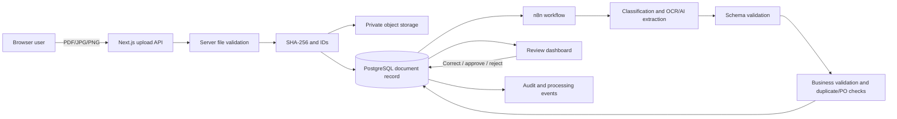

# Proposed Architecture

Status: planning baseline with the verified Milestone 1.1 server boundary recorded below. It must be updated when implementation evidence changes the design.

## Smallest supported architecture

- **Next.js application:** responsive UI, authenticated server boundaries when introduced, upload API, document API, and review actions.
- **Supabase PostgreSQL:** canonical structured data, processing state, review actions, and audit events.
- **Supabase Storage:** private original documents, separate from extracted and corrected data.
- **n8n:** asynchronous processing orchestration, retries, and explicit error routes.
- **AI/OCR provider adapter:** provider-specific requests and responses mapped to internal schemas.
- **Zod schemas:** validation of API input and AI structured output.

No separate Python service, LangChain, Docker, microservices, or Redis is planned for the Core MVP.

## Cost boundary

- The operating budget for external services is zero.
- Hosted components may be used only while their current free plan covers the agreed learning workload and cannot silently create charges.
- Before enabling a hosted dependency, verify its official current free-plan limits and record the relevant constraints.
- When a free quota is unavailable or exhausted, prefer a local implementation, mock adapter, deferred job, or explicit unavailable state over paid usage.
- Provider adapters must allow a paid AI/OCR provider to remain disabled without blocking the rest of the application.

## Data flow



## Upload boundary

For the Core MVP, users upload files through the DocFlow AI website using drag-and-drop or the browser file picker. Mobile users may select an existing image or take a document photo when the browser supports it. Gmail and Drive are not required for the first working flow.

### Implemented in Milestone 1.1

- The primary deployment is a server-capable Next.js 16.4.2 application on Vercel; static export is no longer the current application architecture.
- `POST /api/uploads` accepts one `multipart/form-data` field named `file`.
- The server enforces the 10 MB limit and compares the extension, optional browser-declared MIME type, and PDF/JPEG/PNG byte signature.
- A valid request receives a UUID v4 document ID, UUID v4 correlation ID, safe display filename, detected MIME type, size, and SHA-256.
- The response explicitly reports `status: "validated"` and `persisted: false`. No database record, object storage write, upload queue, or `uploaded` state exists yet.
- Errors contain a stable public code, safe message, and correlation ID. File contents and stack traces are not returned or logged.
- The current handler buffers a maximum 10 MB file in memory to validate and hash it. This is bounded for 1.1 but should be reviewed if the upload limit or processing model changes.
- The browser upload prototype remains disconnected from this API until a separately reviewed substep introduces the real persistence flow.

## Processing state machine

Primary states:

```text
uploaded -> queued -> processing -> needs_review -> approved
                                  |             -> rejected
                                  -> failed
uploaded/processing -> duplicate
```

Every transition must be validated server-side and recorded with timestamp, correlation ID, source, and actor when applicable. Retrying a failed document must not create a second canonical document.

## Review decision signals

`needs_review` should be based on explainable signals rather than an unsupported confidence percentage alone:

- Missing or invalid required fields.
- Ambiguous document type.
- Low-quality OCR or provider uncertainty.
- Inconsistent totals or line items.
- Missing or mismatched purchase order.
- Duplicate signals requiring confirmation.
- Important field warnings for supplier, document number, currency, or total.

## Initial data model draft

| Table | Responsibility |
|---|---|
| `documents` | File identity, type, status, hashes, storage reference, timestamps, correlation ID |
| `extracted_document_data` | Versioned raw normalized extraction, schema version, provider metadata |
| `document_line_items` | Normalized extracted line items |
| `vendors` | Fictional normalized supplier records |
| `purchase_orders` | Purchase-order headers used for matching |
| `purchase_order_items` | Ordered line items |
| `review_actions` | Corrections, comments, approve/reject actions, actor and timestamp |
| `processing_events` | Append-only processing timeline and status events |
| `validation_issues` | Rule, severity, field, human-readable reason, resolution state |
| `document_chunks` | RAG-only chunks for approved documents; not created in Core MVP unless needed |

The final schema, constraints, relationships, and row-level security rules must be approved before database implementation.

## Duplicate and idempotency strategy

- Exact file signal: SHA-256.
- Business identity: normalized supplier plus document number.
- Secondary signal: supplier plus date plus total.
- Database uniqueness and idempotency keys prevent concurrent duplicate creation.
- Reprocessing updates the existing document workflow rather than silently inserting a new canonical record.

## Trust boundaries

- Browser input and document contents are untrusted.
- MIME type, extension, file size, and safe filename handling are server-side responsibilities.
- Instructions embedded in documents are data and must never control system behavior.
- AI output is untrusted until schema and business validation pass.
- Service-role credentials remain server-only.
- n8n callbacks require authentication and correlation checks.
- Logs exclude secrets and full document content.

## Pending architecture decisions

- Initial free-tier or local AI/vision provider and its quota ceiling.
- Supabase hosted development project versus a later local setup.
- Demo authentication depth for the first UI iteration.
- Exact supported currencies and tolerance rules.
- Languages represented in the fixture set.
