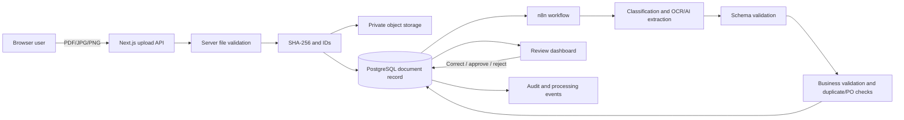

# Proposed Architecture

Status: planning baseline. It must be updated when implementation evidence changes the design.

## Smallest supported architecture

- **Next.js application:** responsive UI, authenticated server boundaries when introduced, upload API, document API, and review actions.
- **Supabase PostgreSQL:** canonical structured data, processing state, review actions, and audit events.
- **Supabase Storage:** private original documents, separate from extracted and corrected data.
- **n8n:** asynchronous processing orchestration, retries, and explicit error routes.
- **AI/OCR provider adapter:** provider-specific requests and responses mapped to internal schemas.
- **Zod schemas:** validation of API input and AI structured output.

No separate Python service, LangChain, Docker, microservices, or Redis is planned for the Core MVP.

## Data flow



## Upload boundary

For the Core MVP, users upload files through the DocFlow AI website using drag-and-drop or the browser file picker. Mobile users may select an existing image or take a document photo when the browser supports it. Gmail and Drive are not required for the first working flow.

## Processing state machine

Primary states:

```text
uploaded -> queued -> processing -> needs_review -> approved
                                  |             -> rejected
                                  -> failed
uploaded/processing -> duplicate
```

Every transition must be validated server-side and recorded with timestamp, correlation ID, source, and actor when applicable. Retrying a failed document must not create a second canonical document.

## Review decision signals

`needs_review` should be based on explainable signals rather than an unsupported confidence percentage alone:

- Missing or invalid required fields.
- Ambiguous document type.
- Low-quality OCR or provider uncertainty.
- Inconsistent totals or line items.
- Missing or mismatched purchase order.
- Duplicate signals requiring confirmation.
- Important field warnings for supplier, document number, currency, or total.

## Initial data model draft

| Table | Responsibility |
|---|---|
| `documents` | File identity, type, status, hashes, storage reference, timestamps, correlation ID |
| `extracted_document_data` | Versioned raw normalized extraction, schema version, provider metadata |
| `document_line_items` | Normalized extracted line items |
| `vendors` | Fictional normalized supplier records |
| `purchase_orders` | Purchase-order headers used for matching |
| `purchase_order_items` | Ordered line items |
| `review_actions` | Corrections, comments, approve/reject actions, actor and timestamp |
| `processing_events` | Append-only processing timeline and status events |
| `validation_issues` | Rule, severity, field, human-readable reason, resolution state |
| `document_chunks` | RAG-only chunks for approved documents; not created in Core MVP unless needed |

The final schema, constraints, relationships, and row-level security rules must be approved before database implementation.

## Duplicate and idempotency strategy

- Exact file signal: SHA-256.
- Business identity: normalized supplier plus document number.
- Secondary signal: supplier plus date plus total.
- Database uniqueness and idempotency keys prevent concurrent duplicate creation.
- Reprocessing updates the existing document workflow rather than silently inserting a new canonical record.

## Trust boundaries

- Browser input and document contents are untrusted.
- MIME type, extension, file size, and safe filename handling are server-side responsibilities.
- Instructions embedded in documents are data and must never control system behavior.
- AI output is untrusted until schema and business validation pass.
- Service-role credentials remain server-only.
- n8n callbacks require authentication and correlation checks.
- Logs exclude secrets and full document content.

## Pending architecture decisions

- Initial AI/vision provider and cost ceiling.
- Supabase hosted development project versus a later local setup.
- Demo authentication depth for the first UI iteration.
- Exact supported currencies and tolerance rules.
- Languages represented in the fixture set.
